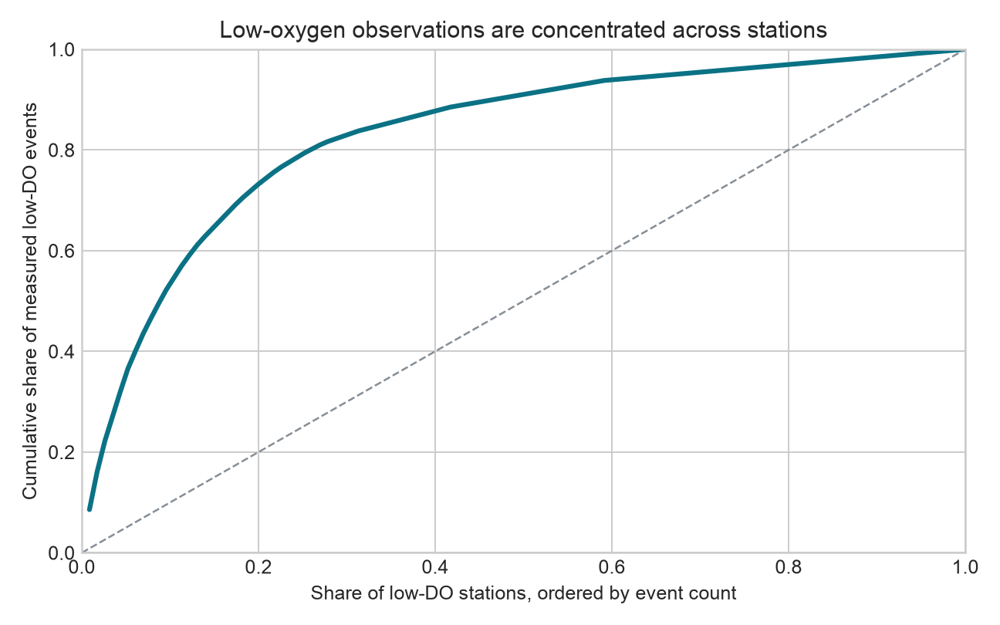
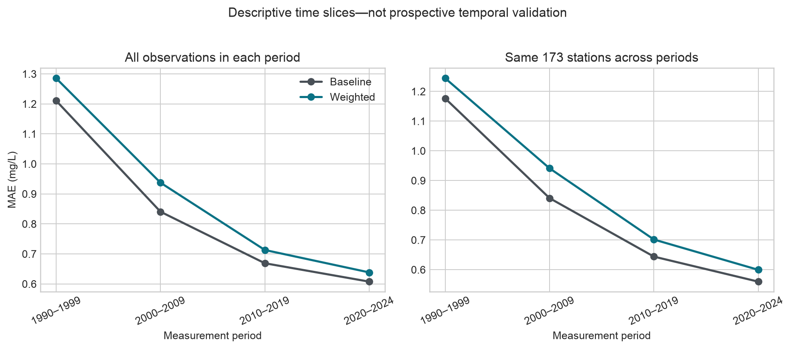
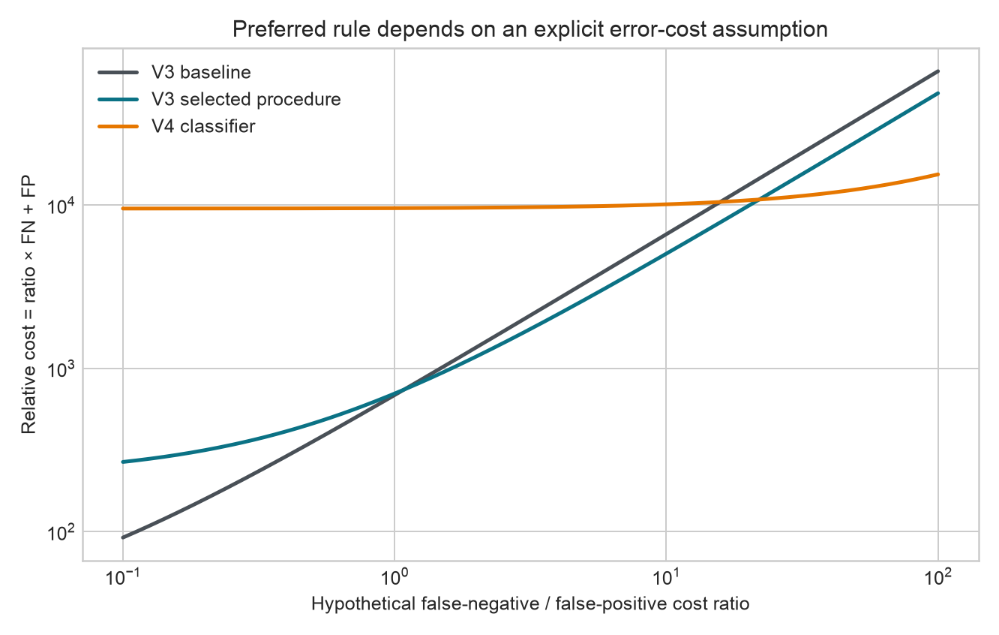
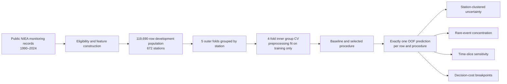

# WaterSense AI

## Why can accurate models fail on rare environmental events?

WaterSense AI is a reproducible study of **dissolved-oxygen reliability at
unseen river-monitoring stations**. Its central result is not a model victory:
improving rare low-oxygen detection reduced misses, but increased overall error
and false alarms.

| Research snapshot | Evidence-backed value |
|---|---:|
| Historical modelling data | 151,031 observations · 840 stations · 1990–2024 |
| Primary V3 development experiment | 119,690 observations · 672 stations · 5 station-disjoint outer folds |
| V3 low-DO MAE | 3.3235 → **2.3613 mg/L** |
| V3 low-DO recall | 0.1293 → **0.3641** |
| Cost of that gain | overall MAE 0.8797 → **0.9516**; false positives 26 → **219** |
| Independent external confirmation | **None** |

> **Scientific takeaway:** the 758 measured low-DO observations occur at 115
> stations, but half come from only ten stations. Their concentration is
> equivalent to 29.7 equally represented stations. This describes concentration,
> not statistical effective sample size. Controlling each station's sampling
> volume still leaves observed HHI 0.03372 versus null mean 0.00352; monitoring
> practice and temporal clustering remain possible explanations.

[Read the manuscript](paper/WATERSENSE_AI_MANUSCRIPT.md) ·
[Inspect the evidence ledger](audits/EVIDENCE_LEDGER.csv) ·
[Reproduce the audit](#reproduce-the-portfolio-audit) ·
[Review limitations](#what-this-project-does-not-establish)

## Three views of the same reliability problem

| Station concentration | Descriptive time slices | Decision trade-off |
|---|---|---|
|  |  |  |
| Half of low-DO events occur at ten stations. | Later-period error is lower even in a 173-station balanced panel, but this is not prospective validation. | The preferred rule changes with the assumed cost of a miss relative to a false alarm. |

## Research question

> Can routine river-water chemistry estimate contemporaneously measured
> dissolved oxygen at monitoring stations excluded from training—and how
> reliable is that estimate for rare observations below 4 mg/L?

The model estimates a current co-measured quantity. It does **not** forecast
future river conditions, classify water as safe, or identify causal mechanisms.

## Experimental design



Station grouping prevents a location from appearing in both sides of an outer
fold. Target, target qualifier, station identity, and location metadata are not
predictors. Earlier random, temporal, spatiotemporal, and basin experiments are
retained because they answer different generalization questions; they are not
interchangeable scores.

[Full protocol](docs/research_protocol.md) ·
[V3 frozen protocol](research_upgrade_v3/phase2b0/WEIGHTED_REGRESSION_FROZEN_PROTOCOL.md) ·
[V4 protocol](research_upgrade_v4_candidate/EXPERIMENT_PROTOCOL.md)

## Primary result: a bounded trade-off

The frozen V3 selected procedure used nested station-grouped development CV.
Every quantitative value below was independently recomputed from the committed
row-level predictions.

| Metric | V3 baseline | V3 selected procedure | Change |
|---|---:|---:|---:|
| Overall MAE (mg/L) | 0.8797 | 0.9516 | +0.0719 |
| Low-DO MAE (mg/L) | 3.3235 | 2.3613 | -0.9622 |
| Low-DO recall | 0.1293 | 0.3641 | +0.2348 |
| Low-DO precision | 0.7903 | 0.5576 | -0.2327 |
| False negatives | 660 | 482 | -178 |
| False positives | 26 | 219 | +193 |

The formal result supports the **complete selected procedure**. It does not
prove that sample weighting alone caused the outer-fold difference, because the
baseline and selected procedure also use different model families and
hyperparameters. Saved matched inner comparisons provide consistent but
exploratory evidence that weighting contributed.

[V3 scientific report](research_upgrade_v3/final_closeout/FINAL_SCIENTIFIC_REPORT.md) ·
[Attribution audit](research_upgrade_v3/experiment1a_attribution/EXPERIMENT1A_ATTRIBUTION_REPORT.md) ·
[W02 documentation erratum](research_upgrade_v3/final_closeout/W02_ERRATUM_2026-10-14.md)

## A negative result worth keeping

A later fixed V4 classifier achieved recall **0.9222**, but precision only
**0.0684**, with **9,517 false positives** and 59 false negatives on the same
reused development population. It uses a different objective and protocol, so
it is not a direct V3 upgrade. It demonstrates why recall alone is an inadequate
definition of reliability.

Under hypothetical cost `r × FN + FP`:

- V3 selected becomes cheaper than V3 baseline at `r > 1.084`;
- V4 classifier becomes cheaper than V3 baseline at `r > 15.792`; and
- V4 classifier becomes cheaper than V3 selected at `r > 21.981`.

These are arithmetic breakpoints, not ecological or regulatory valuations.

Whole-station bootstrap intervals show uncertainty near the crossings. At a
FN/FP cost ratio of 25, classifier-minus-V3-selected cost per 10,000 rows is
-106.69 with a 95% interval [-410.87, 152.11], spanning zero. A point preference
therefore need not be stable. Later decades also have narrower target
distributions; lower overall MAE does not establish better low-DO reliability.

[Sampling controls and uncertainty report](research_extension/sprint/SCIENTIFIC_REPORT.md) ·
[Full execution logs and test outcomes](audits/sprint/execution_summary.json)

[Reliability extension](research_extension/RELIABILITY_AND_ROBUSTNESS_REPORT.md) ·
[V4 scientific report](research_upgrade_v4_candidate/WATERSENSE_V4_SCIENTIFIC_REPORT.md)

## Evidence map

| Question | Start here |
|---|---|
| Which claims are directly verified? | [Claim-by-claim evidence ledger](audits/EVIDENCE_LEDGER.csv) |
| Were frozen metrics reconstructed? | [Machine-readable verification summary](audits/verification_summary.json) |
| What are the scientific integrity findings? | [Scientific integrity report](audits/SCIENTIFIC_INTEGRITY_REPORT.md) |
| Can the analysis be rerun? | [Reproducibility report](audits/REPRODUCIBILITY_REPORT.md) |
| What is the complete research narrative? | [Portfolio manuscript](paper/WATERSENSE_AI_MANUSCRIPT.md) |
| What was new in the extension? | [Analysis protocol](research_extension/ANALYSIS_PROTOCOL.md) |
| What still requires human confirmation? | [Contribution statement](research_upgrade_v3/final_closeout/RESEARCH_CONTRIBUTION_STATEMENT.md) |

Evidence order matters: V3 is the primary frozen development result; V4 and the
portfolio extension are exploratory analyses on the reused development
population; V1/V2 are historical robustness evidence. None is independent
external confirmation.

## Reproduce the portfolio audit

Install the declared dependencies, pull the LFS model if needed, and run:

```bash
python3 -m pip install -r requirements.txt
python3 scripts/run_portfolio_analysis.py
python3 scripts/verify_scientific_sprint.py
python3 -m unittest tests.test_portfolio_analysis -v
```

The analysis script trains no model. It fails if frozen input hashes, row
membership, targets, low-DO labels, unique identities, or station-fold
assignments disagree. It regenerates the new tables, figures, report, and hash
manifest.

Full historical reconstruction additionally requires the exact public raw
export documented in [the dataset guide](docs/dataset.md). Reproducing code and
development predictions does not create new statistical independence.

The sprint records a separate historical V4 suite with six passes, one failure
(old release manifest pins the pre-redesign README) and one error (raw CSV
missing). The main suite has two skipped tests and a skipped four-test class
requiring the missing processed dataset. Full details and validation impact are
in the [reproduction audit](audits/sprint/REPRODUCTION_STATUS.md).

## What this project does not establish

- No independent external region or later period confirms the result.
- Most low-DO observations are still missed by the V3 selected procedure.
- Northern Ireland observations do not establish transfer to other regions.
- Temperature, flow/discharge, and catchment context are absent.
- Repeated rows within station and reused splits are dependent.
- Descriptive time-band results are not future forecasting evidence.
- Feature importance is predictive association, not causation.
- No defensible operational false-negative/false-positive cost has been set.
- The model is not validated for warnings, regulation, safety, or deployment.
- Applicant-specific personal contribution requires owner confirmation.

## Repository guide

```text
paper/                 consolidated research manuscript
audits/                evidence ledger, integrity, reproducibility, evaluation
research_extension/    protocol, generated tables, report, artifact manifest
admissions/             school-specific briefs and interview preparation
figures/                verified portfolio visualizations
src/ and scripts/       analysis and historical experiment code
tests/                  automated boundary and metric checks
research_upgrade_v3/    frozen primary development experiment
research_upgrade_v4_candidate/ exploratory classifier and consistency audit
research_outputs*/      historical V1/V2 robustness evidence
```

The Streamlit research interface remains available with
`streamlit run app/app.py`; it uses the historical deployed estimator and is not
updated by V3, V4, or the portfolio extension.

## Transparency

WaterSense AI is an educational research project. AI systems provided
substantial assistance with implementation, testing, analysis, writing,
visualization, and auditing. The repository does not present AI-generated work
as unaided human work, and personal contribution language remains subject to
owner verification.
