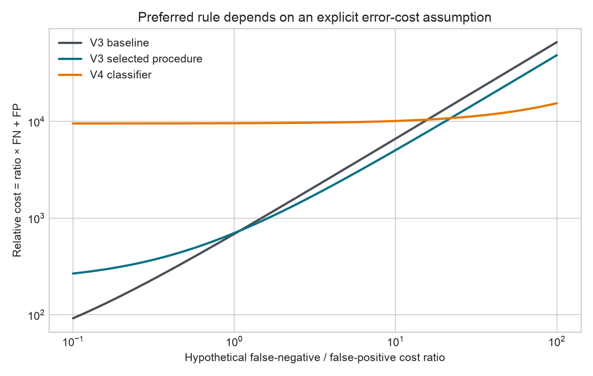

# WaterSense AI: Station-Grouped Evaluation of Rare Low-Oxygen Reliability in Long-Term River Monitoring Data

**Manuscript status:** research portfolio manuscript; not peer-reviewed,
published, accepted, or independently externally validated.  
**Author:** `[OWNER TO CONFIRM NAME AND CONTRIBUTION BEFORE SUBMISSION]`

## Abstract

Machine-learning performance averaged over environmental monitoring records can
hide failure on rare, operationally important conditions. WaterSense AI studies
whether routine physicochemical measurements can estimate contemporaneously
measured dissolved oxygen (DO) at river-monitoring stations excluded from model
training, with special attention to observations below 4 mg/L. The documented
Northern Ireland Environment Agency source contains 178,680 records from 1,311
stations (1990–2024); the historical modelling table contains 151,031 eligible
records from 840 stations. The primary V3 experiment used a frozen nested
station-grouped design on 119,690 development rows from 672 stations. Recomputed
outer out-of-fold results show that the selected low-DO-oriented procedure
reduced low-DO mean absolute error (MAE) from 3.3235 to 2.3613 mg/L and increased
recall from 0.1293 to 0.3641, but worsened overall MAE from 0.8797 to 0.9516
mg/L, reduced precision from 0.7903 to 0.5576, and increased false positives
from 26 to 219. A later fixed classifier reached 0.9222 recall but only 0.0684
precision and 9,517 false positives on the same reused development population.
New exploratory artifact analysis shows that the 758 low-DO observations are
concentrated in 115 stations; the event-share concentration corresponds to only
29.7 equally represented stations. Error-cost breakpoints make the decision
trade-off explicit, while balanced-station time slices show descriptive—not
prospective—variation across decades. The study’s contribution is therefore a
reproducible reliability and failure analysis, not a deployment claim. External
confirmation, application-defined costs, and owner-verified contribution
attribution remain outstanding.

## 1. Introduction

Dissolved oxygen is an important physicochemical property of surface water, but
it is difficult to infer reliably from a small set of routine measurements.
Environmental monitoring records also violate the convenient fiction that each
row is an independent observation: stations are repeatedly sampled, monitoring
practice changes, missingness is structured, and rare events may cluster at a
small number of locations.

The project began as a regression study and evolved into a question about model
reliability. An average error below 1 mg/L can coexist with severe
overprediction of genuinely low DO. That distinction matters scientifically:
a model can be useful for ordinary estimation while remaining unsuitable for
warning decisions.

This manuscript consolidates historical V1–V4 evidence and a new artifact-only
portfolio extension. It reports positive and negative findings together,
separates current-value estimation from forecasting, and distinguishes
development evidence from independent confirmation.

## 2. Related Work

Blocked validation is recommended when ecological data have spatial, temporal,
or hierarchical dependence, because random row splitting can produce
over-optimistic error estimates [1]. WaterSense operationalizes this concern by
grouping on monitoring station and by retaining separate random, grouped,
temporal, spatiotemporal, and basin analyses with different interpretations.

Random forests provide a nonlinear ensemble baseline for regression [2]. The
project also evaluated linear, tree, Extra Trees, and histogram gradient
boosting families through scikit-learn [3]. Model-family breadth was used to
test whether conclusions depended on a single estimator, not to conduct an
unbounded performance search.

Low-DO detection is highly imbalanced. Under strong imbalance, precision and
recall expose false-alarm and miss trade-offs that accuracy or specificity can
obscure [4]. The project therefore reports confusion counts and denominators,
not only area-based summaries. Historical prediction intervals were inspired
by split residual calibration, but coverage under distribution shift must be
interpreted cautiously; distribution-free guarantees depend on assumptions
such as exchangeability [5].

## 3. Research Questions

The primary question is:

> How reliably can routine river-water chemistry estimate contemporaneously
> measured dissolved oxygen at monitoring stations excluded from training?

The portfolio extension addresses four secondary questions:

1. Do row-level frozen artifacts reproduce the published V3/V4 metrics and
   station-fold boundaries?
2. How concentrated are rare `DO < 4 mg/L` events across stations?
3. Does error vary across calendar periods after reducing changes in station
   composition?
4. At what hypothetical false-negative/false-positive cost ratios does the
   preferred development rule change?

No question asks whether the model forecasts future DO, establishes a causal
environmental mechanism, or is ready for regulatory use.

## 4. Dataset and Provenance

The source is *River Water Quality Monitoring 1990 to 2024 — All Parameters*,
published by OpenDataNI/NIEA under the UK Open Government Licence [6]. The
source catalogue warns that extreme values may include genuine events as well
as errors caused by sampling, contamination, or typographical mistakes.

| Property | Historical verified value | Evidence |
|---|---:|---|
| Raw rows / columns | 178,680 / 40 | `research_upgrade_v3/phase2b0/DATA_RECOVERY_REPORT.md` |
| Raw stations | 1,311 | same |
| Modelling rows / stations | 151,031 / 840 | `research_outputs/manifest.json` |
| Dates | 1990-01-02 to 2024-12-11 | same |
| V3 development rows / stations | 119,690 / 672 | recomputed from V3 predictions |

The target is the original DO measurement in mg/L. Rows with missing targets
and six qualified targets were excluded historically. Predictor values reported
with censor qualifiers retained their numeric export values plus explicit
indicator features. Predictor missingness was handled by training-fold median
imputation with missingness indicators. The raw and complete processed tables
are ignored by Git; frozen predictions and manifests are public.

An exact recovery was attempted on 2026-11-03. The repository’s Python client
failed TLS certificate validation and the frozen download URL returned HTTP 500
through the system client. Therefore raw-table claims are `REPORTED_ONLY` in the
current audit, while prediction-level claims are independently recomputed.

## 5. Experimental Methodology

### 5.1 Predictors and preprocessing

The historical full feature set combines routine chemistry, censor flags,
missingness information, and cyclical day-of-year context. Station identifiers,
coordinates, database identifiers, raw date identifiers, target, and target
qualifier are excluded from predictors. Pipelines learn preprocessing only from
the applicable training rows. Synthetic tests verify this boundary.

### 5.2 Historical development sequence

- **V1:** fixed Random Forest evaluated under random-row, unseen-station,
  future-year, and spatiotemporal designs; feature ablation and residual
  diagnostics were retained.
- **V2:** ten predefined spatiotemporal splits, one basin holdout, reduced
  ablations, interval coverage, importance stability, and fixed model-family
  checks. These are robustness analyses on previously studied data.
- **V3:** frozen nested station-grouped model/weight selection targeted low-DO
  reliability on a 119,690-row development partition. The baseline was a fixed
  Random Forest; the selected procedure chose among Random Forest, Extra Trees,
  and HistGradientBoosting configurations crossed with weights 1, 2, 4, and 8.
- **V4:** one fixed, balanced logistic classifier at probability threshold 0.5
  on the same development folds. It changed the objective from regression to
  classification and is not a direct V3 upgrade.

### 5.3 Portfolio extension

The extension performs no fitting. It reads the checksum-verified V3/V4 OOF
predictions, enforces identity invariants, recomputes metrics, and produces
descriptive station, time, and cost analyses under a written protocol.

## 6. Validation Design

Station grouping is the central protection against location leakage. V3 uses
five outer folds with 672 stations, and each station appears in exactly one
outer validation fold. Inner selection uses four station-grouped folds within
each outer training partition. This design estimates transfer to other stations
within the same historical monitoring system; it does not estimate transfer to
another country or a future monitoring regime.

The project retains several validation settings because each answers a different
question. Random-row evaluation approximates interpolation among known sites;
station-grouped evaluation tests unseen-site transfer; temporal evaluation tests
later observations that often include known sites; and spatiotemporal evaluation
holds out later rows at stations excluded from training. Their metrics are not
interchangeable.

Earlier holdouts have been repeatedly inspected and cannot be relabelled as
fresh confirmation. A V4 audit found that the then-current official export was
byte-identical to the historical source. No external predictions were made.

## 7. Statistical Analysis

For observations \(i=1,\ldots,n\), MAE is

\[
\mathrm{MAE}=\frac{1}{n}\sum_i |\hat y_i-y_i|.
\]

Low-DO MAE restricts the sum to measured \(y_i<4\) mg/L. Recall is
\(TP/(TP+FN)\) and precision is \(TP/(TP+FP)\); all denominators and raw counts
are retained.

Historical V3 uncertainty uses paired bootstrap resampling of whole stations,
not rows. This respects the principal sampling cluster but does not create a new
population. The extension quantifies event concentration by station shares
\(p_s=n_s/\sum_s n_s\), with Herfindahl index \(H=\sum_s p_s^2\) and inverse
effective count \(1/H\). The effective count is a concentration analogy, not a
claim that exactly 29.7 statistically independent observations exist.

Time bands are fixed at 1990–1999, 2000–2009, 2010–2019, and 2020–2024. Pooled
MAE is accompanied by a station-macro sensitivity analysis restricted to the
173 stations represented in all bands. Hypothetical decision cost is

\[
C(r)=r\,FN+FP, \qquad r=C_{FN}/C_{FP}.
\]

Pairwise breakpoints are solved algebraically; no cost value is fitted to the
data.

## 8. Results

### 8.1 Historical robustness

Across ten predefined V2 spatiotemporal splits, mean MAE was 0.6793 mg/L (SD
0.0353). Low-DO subsets contained only 3–21 rows per split and had MAE
2.8846–4.7678 mg/L. Nine of ten splits overpredicted every low-DO observation.
These are historical reported values; they demonstrate partition sensitivity
but are not ten independent datasets.

### 8.2 V3 low-DO trade-off

| Metric | Baseline | Selected procedure | Change |
|---|---:|---:|---:|
| Overall MAE (mg/L) | 0.8797 | 0.9516 | +0.0719 |
| Low-DO MAE (mg/L) | 3.3235 | 2.3613 | -0.9622 |
| Low-DO bias (mg/L) | 3.3080 | 2.2373 | -1.0707 |
| Recall | 0.1293 | 0.3641 | +0.2348 |
| Precision | 0.7903 | 0.5576 | -0.2327 |
| False negatives | 660 | 482 | -178 |
| False positives | 26 | 219 | +193 |

Historical paired station-bootstrap 95% intervals exclude zero beneficially for
low-DO MAE and recall, and exclude zero adversely for overall MAE and precision.
The frozen decision rule therefore supported the selected procedure for its
bounded co-primary objectives. It did not establish a globally better model.

### 8.3 Attribution boundary

The formal outer comparison changes architecture, non-weight hyperparameters,
and weight. It cannot identify a weight-only causal effect. In saved inner-grid
results, 640 exact comparisons holding architecture, hyperparameters, folds,
preprocessing, and training flow constant all moved low-DO MAE and recall in a
beneficial direction when changing weight 1 to 8. Because inner folds are reused
and the analysis is post hoc, this is strong exploratory consistency evidence,
not 640 independent replications.

### 8.4 V4 classifier failure trade-off

The fixed classifier produced TP 699, FP 9,517, TN 109,415, and FN 59: recall
0.9222, precision 0.0684, and F1 0.1274. High recall was obtained by generating
false alarms on approximately 8.0% of measured non-low-DO rows. The negative
result is scientifically useful because it shows why recall alone is not an
adequate selection criterion.

### 8.5 Station concentration

The 758 low-DO observations occur at 115 stations; 47 stations have exactly one
event. The top station contributes 8.6% of events, the top five 31.9%, and the
top ten 49.5%. \(H=0.0337\), so \(1/H=29.7\) equally represented stations.


### 8.6 Descriptive temporal sensitivity

Baseline pooled MAE declines from 1.211 mg/L in 1990–1999 to 0.608 mg/L in
2020–2024. Among the same 173 stations represented in all periods, station-macro
MAE declines from 1.176 to 0.560 mg/L. The selected procedure shows the same
direction. This suggests station membership alone is insufficient to explain
the pattern, but does not distinguish changes in measurement practice,
covariates, event composition, or relationships.


### 8.7 Decision breakpoints

V3 selected has lower hypothetical cost than V3 baseline only when
\(C_{FN}/C_{FP}>1.084\). V4 classifier crosses V3 baseline at 15.792 and V3
selected at 21.981. These are transparent implications of development counts,
not recommended real-world valuations.



## 9. Robustness and Failure Analysis

The main result survives several checks: five outer station folds, paired
membership, station-clustered bootstrap intervals, exact artifact
reconstruction, matched inner weight comparisons, repeated earlier
spatiotemporal splits, and a balanced-station time sensitivity analysis.

The failures are equally important:

- most V3 low-DO events remain missed (FN rate 0.6359);
- the selected procedure raises overall error and false alarms;
- V4 obtains high recall with extremely low precision;
- aggregate prediction-interval coverage historically concealed very poor
  low-DO coverage;
- rare events are concentrated across a small number of stations;
- prior data reuse limits prospective interpretation; and
- no new region or time period has confirmed the effect.

## 10. Discussion

WaterSense is strongest as a study of objective mismatch. Standard regression
selection rewards performance where observations are abundant. Weighting rare
events or switching to a classifier reallocates errors, but the preferred
allocation depends on an application-defined loss function. The data alone
cannot decide how many false alarms equal one missed low-oxygen observation.

The concentration analysis changes the apparent evidence scale without
discarding information. Row-level performance is still relevant, but station
clusters—not individual measurements—are the more credible unit for uncertainty
about geographic transfer. This is why the project reports both event counts
and station structure.

The temporal result is deliberately restrained. Lower later-period error could
reflect improved measurement consistency, different sampling, a narrower target
distribution, or model access to patterns learned from all eras. It does not
prove that the model has improved over time and does not support forecasting.

## 11. Limitations

1. Data come from one Northern Ireland monitoring system.
2. Water temperature, flow, catchment state, and other physical drivers are
   absent from the frozen predictor set.
3. Measurements within station and across repeated splits are dependent.
4. Rare-event station support is limited and uneven.
5. Historical holdouts were inspected during iterative research.
6. V3’s outer comparison does not isolate weighting from model selection.
7. V4 changes the objective and is not directly comparable as an upgrade.
8. Time-band analysis is descriptive rather than prospective.
9. Prediction intervals can fail under spatial or temporal distribution shift.
10. No ecological, regulatory, or financial cost ratio has been established.
11. No external population has confirmed the findings.
12. Applicant-specific personal contribution has not yet been authenticated.

## 12. Conclusion

WaterSense AI demonstrates that rigorous evaluation can turn an apparently
successful regression model into a more informative scientific result. The
selected procedure materially improves low-DO development performance, but the
cost appears in overall error and false alarms, and a high-recall classifier
amplifies that trade-off dramatically. Rare-event evidence is concentrated
across stations, reinforcing the need for group-aware validation and
cluster-aware uncertainty.

The next scientifically decisive step is not another search on the same data.
It is evaluation of a frozen rule on a genuinely new, compatible population
under a decision policy defined independently of model outcomes.

## 13. References

1. Roberts, D. R., et al. (2017). Cross-validation strategies for data with
   temporal, spatial, hierarchical, or phylogenetic structure. *Ecography*,
   40, 913–929. <https://doi.org/10.1111/ecog.02881>
2. Breiman, L. (2001). Random Forests. *Machine Learning*, 45, 5–32.
   <https://doi.org/10.1023/A:1010933404324>
3. Pedregosa, F., et al. (2011). Scikit-learn: Machine Learning in Python.
   *Journal of Machine Learning Research*, 12, 2825–2830.
   <https://www.jmlr.org/papers/v12/pedregosa11a.html>
4. Saito, T., & Rehmsmeier, M. (2015). The Precision-Recall Plot Is More
   Informative than the ROC Plot When Evaluating Binary Classifiers on
   Imbalanced Datasets. *PLOS ONE*, 10(3), e0118432.
   <https://doi.org/10.1371/journal.pone.0118432>
5. Lei, J., G’Sell, M., Rinaldo, A., Tibshirani, R. J., & Wasserman, L. (2018).
   Distribution-Free Predictive Inference for Regression. *Journal of the
   American Statistical Association*, 113(523), 1094–1111.
   <https://doi.org/10.1080/01621459.2017.1307116>
6. OpenDataNI / Northern Ireland Environment Agency. *River Water Quality
   Monitoring 1990 to 2024 — All Parameters*. UK Open Government Licence.
   <https://www.data.gov.uk/dataset/15ec8080-ee1c-469b-858e-546d2fb57c27/riverwaterqualitymonitoring-1990to2024-allparameters13>

## 14. Reproducibility Statement

The repository preserves code, frozen configurations, fold assignments,
row-level compressed predictions, bootstrap summaries, tests, and hashes.
Portfolio verification is run with:

```bash
python3 scripts/run_portfolio_analysis.py
python3 -m unittest tests.test_portfolio_analysis -v
```

The script fails on input-hash, membership, target, duplicate-identity, or
station-fold mismatch. Full historical retraining additionally requires the
exact ignored public export documented in `docs/dataset.md`. Reproducibility of
development artifacts does not create statistical independence.

## 15. AI Assistance and Contribution Disclosure

AI systems provided substantial assistance with coding, testing, statistical
checks, figure generation, prose drafting, repository auditing, and portfolio
organization. No claim is made that the work was completed without AI.

`[OWNER CONFIRMATION REQUIRED: identify the research questions, design choices,
code, analyses, interpretations, and revisions personally performed or
independently verified by the applicant before using first-person authorship
language.]`

The scientific claims in this manuscript are limited to traceable repository
artifacts. AI assistance does not substitute for owner review or external peer
review.
