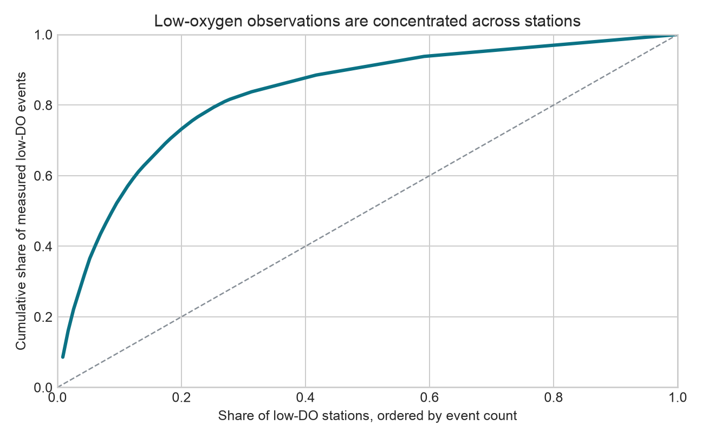
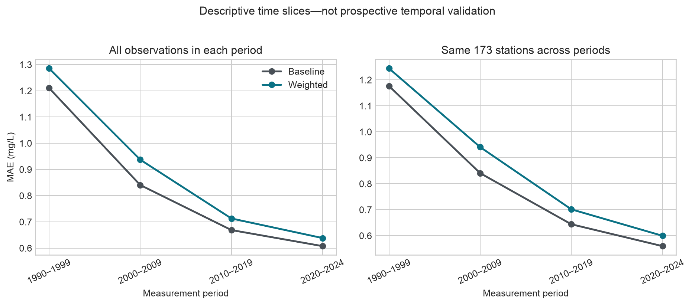
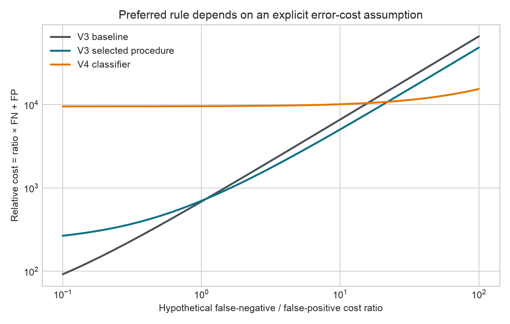

# Station reliability, time slices, and decision trade-offs

## Status

**EXPLORATORY / DEVELOPMENT-ONLY.** This report recomputes frozen V3 and V4
outer out-of-fold predictions. It does not train a model or provide independent
external validation.

## Reconstruction result

Both V3 variants contain 119,690 unique observations from
672 stations, with identical identities, targets, dates, and
outer folds. Each station occurs in exactly one outer fold. The strict low-DO
definition is measured `DO < 4 mg/L`.

| Quantity | V3 baseline | V3 selected procedure |
|---|---:|---:|
| Overall MAE (mg/L) | 0.8797 | 0.9516 |
| Low-DO MAE (mg/L) | 3.3235 | 2.3613 |
| Recall | 0.1293 | 0.3641 |
| Precision | 0.7903 | 0.5576 |
| False negatives | 660 | 482 |
| False positives | 26 | 219 |

The procedure improves the rare-event objectives but worsens overall MAE and
false alarms. It must not be summarized as an unqualified model improvement.

## Finding 1 — effective rare-event evidence is much smaller than 758 rows

The 758 measured low-DO observations occur at only
115 of 672 development stations.
47 stations contain exactly one
event. The largest station supplies 8.6%
of all events; the largest five supply 31.9%,
and the largest ten 49.5%. The event-share
Herfindahl index is 0.0337, equivalent to only
29.7 equally represented
stations.

This does not invalidate the row-level metrics. It changes their interpretation:
758 dependent observations are not 758 independent replications, and station-
clustered uncertainty is essential.

## Finding 2 — time-band improvement is descriptive, not forecasting evidence

Baseline pooled MAE is 1.211 mg/L in 1990–1999 and
0.608 mg/L in 2020–2024. The same direction appears
when macro-averaging the 173 stations represented
in all four periods (1.176 to
0.560 mg/L). That sensitivity check
shows that changing site membership alone does not explain the pattern.

It still cannot identify a temporal cause: the models were trained using other
rows from all eras, monitoring practice and case mix can change, and no 2025+
period was held prospectively untouched.

## Finding 3 — model preference is a decision problem

With hypothetical cost `r × FN + FP`, the V3 selected procedure becomes less
costly than the V3 baseline only when a false negative is valued above
**1.084** false positives. The V4 classifier
becomes less costly than V3 selected only above **21.981**,
and less costly than the V3 baseline only above **15.792**.

| Rule | FN | FP |
|---|---:|---:|
| V3 baseline | 660 | 26 |
| V3 selected procedure | 482 | 219 |
| V4 classifier | 59 | 9517 |

These breakpoints are arithmetic consequences of the saved development
confusion matrices. They are not recommended operational costs.

## Scientific conclusion

The strongest defensible contribution is a reliability result, not a deployment
claim: group-aware development evidence shows that rare low-oxygen detection can
be improved only by accepting measurable costs elsewhere, and the apparent
amount of rare-event evidence shrinks substantially after respecting its station
concentration. Independent external confirmation and an application-defined
cost policy remain necessary.
