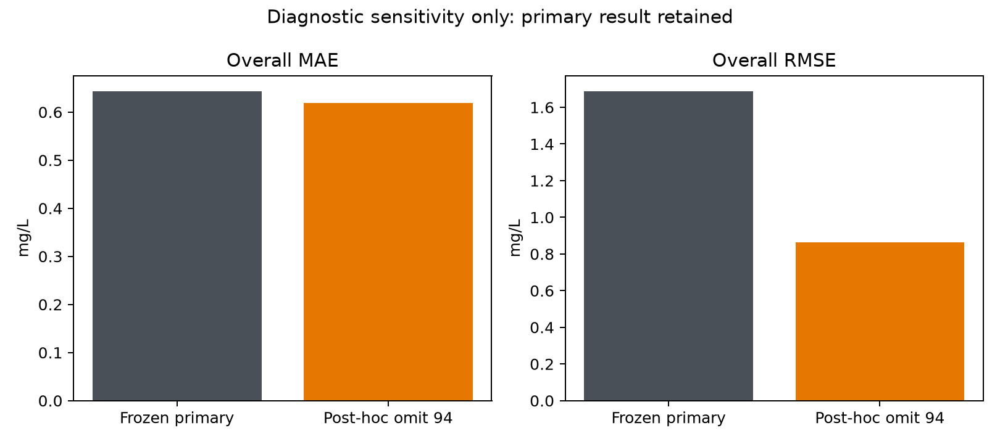

# DO=94 mg/L: post-hoc diagnostic sensitivity

The single record was flagged after inspecting 2025 outcomes. This analysis is
post hoc, is not confirmation, and does not change any frozen result or model.
Only saved predictions are read; no prediction, fitting or tuning occurs.

Source row ID 4859 (CSV line 4860),
station UKGBNIF10937, 2025-08-07, contains DO=94 mg/L,
saturation=10%, temperature=18 C, with no target qualifier. Other nonmissing
2025 DO values at this station span 8.6–13.4 mg/L. The combination is internally
suspicious and could reflect a transcription/column/decimal problem; neither a
specific mechanism nor a correct replacement value is verified.

| Analysis | n | MAE mg/L | RMSE mg/L | R² | Low-DO MAE | Recall | TP/FP/TN/FN |
|---|---:|---:|---:|---:|---:|---:|---|
| Frozen primary | 3490 | 0.643181 | 1.687180 | 0.415046 | 2.288754 | 0.15 | 3/0/3470/17 |
| Post-hoc omit flagged row | 3489 | 0.618805 | 0.861795 | 0.740684 | 2.288754 | 0.15 | 3/0/3469/17 |

The flagged row supplies 73.92% of total
squared error. Removing it changes target variance as well as squared error,
so the R² change must not be read as pure estimator improvement. The 17/20
low-DO misses are unchanged. This diagnostic does not resolve selection from
missing targets or create additional rare-event stations.

All primary 2025 files are checked against their existing hashes. No corrected
DO value or preferred alternative metric replaces the frozen main result.
