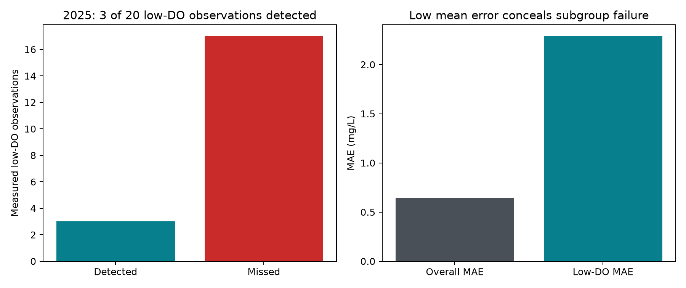

# 2025 acquired temporal confirmation of the frozen Phase4 model

## Evidence boundary

This evaluation uses a newly acquired later period in the same NIEA monitoring
programme. It does not establish cross-region transport, future forecasting, or
confirmation of the V3 weighted selected procedure. The input mapping, model,
threshold, exclusions and interval code were frozen in commit `2a55e5a` before
the single prediction execution. The local freeze is not independent preregistration.

Official source: [DAERA/26-784](https://www.daera-ni.gov.uk/publications/daera26-784-river-water-quality-monitoring-data-all-northern-ireland-2025),
published 2026-10-26. Contains public sector information licensed under the
[OGL](https://www.daera-ni.gov.uk/articles/crown-copyright-daera); no endorsement.

## Cohort and exclusions

6,080 source rows / 503 stations. Two conflicting same-station/date/time/depth
records were excluded together under a documented pre-freeze amendment. Both
had missing target values. Of the remaining 6,078 rows, 2,588 missing targets
were excluded; no qualified target survived. Final cohort: 3,490 rows / 494
stations. No historical station/date pair overlaps the 2025 data.

493 of 494 stations appear somewhere in the historical monitoring programme.
Relative to the actual model training partition, 391 known stations supply
2,777 rows; 103 unseen training stations supply 713 rows. Thus temporal novelty
is stronger than geographic novelty. Sampler identities and coordinates are
not predictors or republished derived outputs. New temperature data are unused.

## Results and whole-station uncertainty

| Metric | Estimate | 95% station-bootstrap interval |
|---|---:|---|
| Overall MAE (mg/L) | 0.6432 | [0.5896, 0.7176] |
| Overall RMSE (mg/L) | 1.6872 | not bootstrapped in the frozen primary plan |
| R² | 0.4150 | not bootstrapped in the frozen primary plan |
| Low-DO MAE (mg/L) | 2.2888 | [1.9237, 2.6796] |
| Recall | 0.1500 | [0.0000, 0.3462] |
| Precision | 1.0000 | conditional [1,1], **not informative about unseen false alarms** |

TP=3, FP=0, TN=3470, FN=17. Low-DO prevalence is 20/3490=0.5731%.
Only nine stations contain low-DO events, below the predeclared ten-station
support criterion. This triggers insufficient support for stable rare-event
reliability claims; no cohort expansion or tuning follows the result.

All three positive predictions occur at **1 station**. In 1,844 of
5,000 complete-station bootstrap draws no positive prediction is present, so
precision is undefined. The conditional [1,1] interval among 3,156 valid draws
is a boundary artifact of resampling an observed dataset with zero false
positives, not proof of perfect precision. Other metrics have 5,000 valid draws.

Known-training-station recall is 3/15=0.20. Unseen-training-station recall is
0/5=0 and precision is undefined, with events at only two stations; this stratum
cannot support a stable geographic-transfer claim.

## Historical comparison and distribution shift

The identical saved Phase4 model had historical station-holdout MAE 0.8312,
RMSE 1.2911 and R² 0.5391. In 2025 MAE is lower while RMSE is higher and R²
lower. Different populations and measurement conditions prevent interpreting
that contrast as model improvement. V3 OOF baseline/selected results remain
development evidence and are not an external weighted/unweighted comparison.

| Same saved model, different evaluation populations | Historical holdout | 2025 |
|---|---:|---:|
| Rows | 31,341 | 3,490 |
| Low-DO observations / stations | 167 / 31 | 20 / 9 |
| Low-DO MAE (mg/L) | 3.1387 | 2.2888 |
| Recall | 0.0838 | 0.1500 |
| Precision | 0.7000 | 1.0000 (three predictions only) |
| TP / FP / TN / FN | 14 / 6 / 31168 / 153 | 3 / 0 / 3470 / 17 |

Historical values are recomputed from the preserved Phase4 prediction table.
Neither prevalence nor station support is matched; this is a descriptive
comparison, not a paired superiority experiment.

Suspended-solids missingness rises from 26.00% in historical training to 75.10%
in the 2025 cohort. BOD missingness rises from 3.49% to 8.54%; pH from 1.30%
to 8.51%. Conductivity missingness falls from 26.04% to 8.51%. Feature means,
medians and quantiles are retained without adapting the frozen imputer.

One supplied DO value is 94.0 mg/L with prediction
8.307 mg/L. Its absolute error is 85.693
mg/L and it materially affects RMSE. The measurement's validity is unresolved;
it remains in the primary result under the frozen no-outlier-filter rule.
No favorable post-hoc exclusion is substituted.

## Conclusion

New-period evidence reproduces the substantive failure pattern: acceptable
average absolute error coexists with missing 85% of measured low-DO rows.
The test supports the existence of this observed failure in 2025, while sparse
event-bearing stations and degenerate precision uncertainty limit reliability
claims. Cross-region external validation and independent confirmation of V3
remain outstanding.
