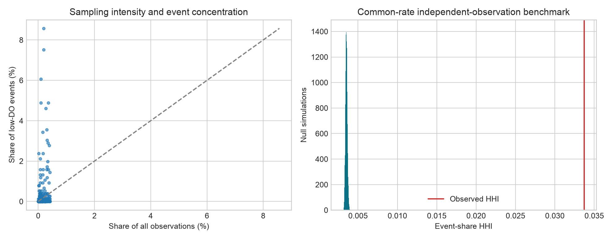
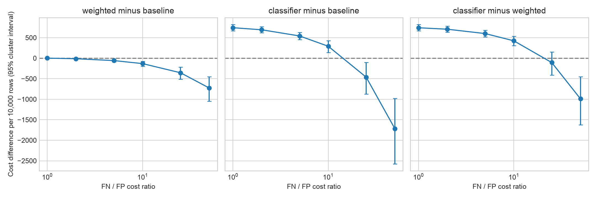
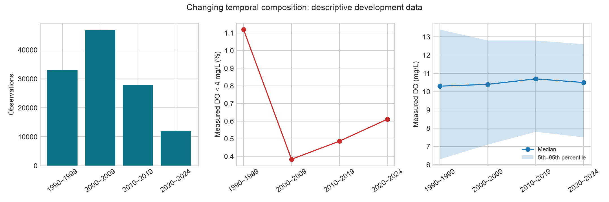

# Final scientific strengthening: sampling effort and uncertainty

Exploratory analyses of frozen development OOF predictions. Protocol:
[SPRINT_PROTOCOL](../SPRINT_PROTOCOL.md). Seed 20261103; no refitting or threshold
changes. Tables and figures are regenerated by
`python3 scripts/run_scientific_sprint.py`.

## Sampling intensity does not explain concentration under the specified null

The station table includes all 672 stations, including those with no measured
low-DO event. It records observation counts, events, occurrence proportions,
sampling shares, event shares and their ratios. The pooled occurrence proportion
is 758/119690 = 0.6333%. An event rate is a proportion among sampled records,
not the fraction of time a river is hypoxic.

For each station with n_s observations, 20,000 simulations generate independent
K_s ~ Binomial(n_s, 0.006333). This holds sampling volumes fixed and lets total
events vary. It therefore includes finite-event variation as well as sampling
imbalance. Observed HHI is 0.033723 versus null mean 0.003523 and a central 95%
reference range [0.003295, 0.003773]. None of 20,000 draws reaches the observed
value; the add-one upper-tail fraction is 1/20001 = 0.000050. This is a Monte
Carlo resolution bound, not evidence that the true probability equals zero.

| Minimum records per station | Retained stations | Events | Observed HHI | Null mean | Null central 95% range |
|---|---:|---:|---:|---:|---|
| 1 | 672 | 758 | 0.033723 | 0.003523 | [0.003295, 0.003773] |
| 10 | 625 | 757 | 0.033810 | 0.003530 | [0.003303, 0.003784] |
| 30 | 601 | 727 | 0.035909 | 0.003603 | [0.003369, 0.003863] |
| 100 | 462 | 630 | 0.045966 | 0.004141 | [0.003863, 0.004453] |

The all-record sampling-share HHI is 0.002213. The observed event HHI is about
9.57 times the null mean; this ratio is descriptive and does not allocate a
causal percentage of concentration to sampling effort. The sensitivity checks
exclude low-volume stations and still lie beyond every corresponding null draw.

The constant-rate independent-observation null is intentionally simple. Real
events can cluster in time; stations cover different years, seasons, monitoring
priorities and measurement conditions. Thus the result rejects sampling volume
as a sufficient explanation **under this benchmark**, but does not identify
intrinsic station risk, geographic hot spots, or a causal environmental effect.
Station rates with small denominators are particularly unstable. Inverse HHI
29.7 is a concentration equivalent only, never a statistical effective sample size.

## Paired station-cluster uncertainty

Each of 5,000 bootstrap draws samples 672 whole stations with replacement. A
station's complete observations and all model outputs receive the same draw
multiplicity. Percentile intervals are conditional on frozen OOF fits; they do
not include fitting or model-selection uncertainty, spatial dependence between
stations, or independent population shift. All reported metric replicates have
defined denominators (5,000 valid, zero undefined).

| Metric | Baseline estimate [95% interval] | V3 selected estimate [95% interval] | Paired change [95% interval] |
|---|---|---|---|
| Overall MAE (mg/L) | 0.8797 [0.8460, 0.9161] | 0.9516 [0.9167, 0.9890] | +0.0719 [0.0643, 0.0799] |
| Low-DO MAE (mg/L) | 3.3235 [2.9781, 3.6744] | 2.3613 [2.0278, 2.7220] | -0.9622 [-1.0838, -0.8514] |
| Recall | 0.1293 [0.0582, 0.1987] | 0.3641 [0.2632, 0.4624] | +0.2348 [0.1878, 0.2799] |
| Precision | 0.7903 [0.5946, 0.9051] | 0.5576 [0.4365, 0.6568] | -0.2327 [-0.3123, -0.1264] |

V4 classifier recall is 0.9222 [0.8896, 0.9482] and precision 0.0684
[0.0490, 0.0897]. It retains 9,517 FP and 59 FN. These results quantify both
benefit and cost; architecture and weighting remain confounded in V3's outer
comparison. New bootstrap intervals use their own recorded seed and are not
substituted into the historical frozen tables.

## Decision preference is uncertain near crossings

Define delta as first-model minus second-model cost per 10,000 observed rows;
negative favors the first. Every replicate computes its own row denominator.
All three pairs and fixed ratios 1,2,5,10,25,50 are retained in the CSV.

| First minus second | FN/FP ratio | Delta | Paired cluster 95% interval | Bootstrap fraction delta < 0 |
|---|---:|---:|---|---:|
| V3 selected minus baseline | 1 | +1.25 | [-4.04, 6.32] | 0.305 |
| V3 selected minus baseline | 2 | -13.62 | [-24.51, -4.28] | 0.999 |
| V4 classifier minus V3 selected | 10 | +423.43 | [303.37, 532.48] | 0.000 |
| V4 classifier minus V3 selected | 25 | -106.69 | [-410.87, 152.11] | 0.769 |
| V4 classifier minus V3 selected | 50 | -990.22 | [-1625.89, -454.05] | 1.000 |

The arithmetic crossings 1.084 and 21.981 are point summaries. At ratio 25,
the classifier's estimated advantage over V3 selected has an interval spanning
zero. Bootstrap stability fractions are neither posterior probabilities nor
independent confirmation. Costs remain hypothetical.

## Temporal composition qualifies the lower later-period error

| Period | Rows | Stations | Low-DO % | Target mean / SD | Target 5th / 50th / 95th percentiles | Baseline MAE | Low-DO MAE |
|---|---:|---:|---:|---|---|---:|---:|
| 1990–1999 | 33,043 | 297 | 1.120 | 10.234 / 2.588 | 6.3 / 10.3 / 13.4 | 1.211 | 3.110 |
| 2000–2009 | 46,919 | 542 | 0.384 | 10.297 / 1.774 | 7.1 / 10.4 / 12.8 | 0.841 | 3.957 |
| 2010–2019 | 27,776 | 445 | 0.486 | 10.539 / 1.627 | 7.8 / 10.7 / 12.8 | 0.669 | 3.193 |
| 2020–2024 | 11,952 | 405 | 0.611 | 10.388 / 1.635 | 7.5 / 10.5 / 12.6 | 0.608 | 3.085 |

Target spread narrows and prevalence changes nonmonotonically. Lower overall
error therefore does not establish improved rare-event reliability: low-DO
MAE remains around 3–4 mg/L. The existing 173-station panel controls membership
only; it does not control within-station sampling times, target case mix, or
methods. Prospective generalization requires a later period withheld from all
model development. No such experiment occurred here.

## Incremental contribution and limitations

Beyond standard blocked validation, the sprint tests a concrete explanation for
rare-event concentration (sampling volume), adds paired uncertainty to decision
costs, and shows how temporal case mix complicates apparent progress. It does
not introduce an algorithm or establish transportability. External confirmation,
physical covariates, a real loss policy and authenticated applicant contribution
remain missing.
